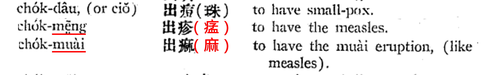
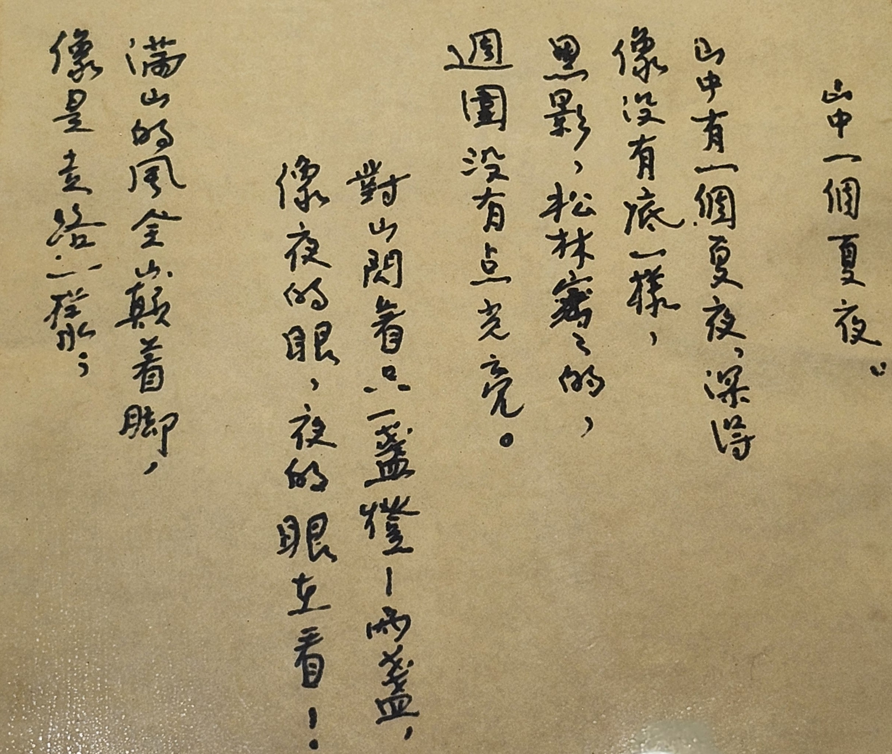

網路上有一部AI電影短片《因為愛》[^1] --- 致敬「福州女兒」 林徽因。短片中有一段福州話（林民璋先生配音， 2:45開始），演示林徽因小時候「長水痘」的情況，充分展現福州方言古樸文雅的聲韻，及細膩精準的敘事張力。

[^1]: <https://news.qq.com/rain/a/20250506V08D2200?id=20250506V08D2200&path=a&app=news&suid=&redirect_pc=1>

| 福州話逐字稿 | 華語字幕 |
|:-----------------------------------|:-----------------------------------|
| [我做細的辰候，得著一種病。 伊各儂講，嚽號喇出𤷪，也有講號喇出珠，固蜀隻講號喇（水疱?）。 唉啊，蜀面野癢！大人講，都伓通掏挖啊，挖了明旦大了變麻面啊，連作新婦都無處作。 嚽就是我蜀厝儂講話的聲音。]{style="color: blue;"} | 在我很小的時候，得了一種病。 家裡人說這叫出麻疹，也有人說這叫做水珠，還有一個說這叫水泡。 唉呀！整張臉很癢。大人說，千萬不可以用手撓啊，撓了以後長大會麻臉，嫁都嫁不出去。 這就是我全家講話的聲音。 |
 
林徽因小時候得的究竟是什麼病? 短片中的福州話有三種說法：出𤷪、出珠、（水疱?）。根據1929年出版的《閩英大辭典》[^2] ，似可對應到：出（痘）珠、出疹（𤷪，讀音meng）、出痲（麻，讀音muai），如下圖。其注釋與個人母語記憶大抵若合符節。

[^2]: Samuel H. Leger, **FOOCHOW DICTIONARY**, 3rd《閩英大辭典》(1929).

{.lightbox fig-align="left" width="95%"}

**出珠**：可以指長水痘（chicken pox），或是出天花（small-pox）。若是長水痘，通常不致於造成麻臉；如果是天花，則有可能造成麻臉。1980年後，天花大致絕跡（現在已經沒有種牛痘了）。所以現在如果講「出珠」或是「出水珠」應是指「長水痘」。但在林徽因那個時代，是有可能染上天花的，所以短片中才會提到「…大了變麻面啊」。

**出疹**（**𤷪**）和**出痳**都是指出麻疹（measles）：𤷪是俗字，痲是麻的異體字。出疹（**𤷪**）可能指麻疹的潛伏期或前期? 而**出麻**則可能指出疹期，大面積（eruption）出現疹子。

福州話俗諺：「出麻離耳後、出珠免水痘」，[^3] 似亦可佐證上述徵狀。 麻疹的典型出疹順序通常是從耳後和髮際開始，此時稱出疹（**𤷪**），然後逐漸蔓延到面部、頸部和四肢，此時稱出麻。而天花和水痘的英文都有 pox，通常就是指「痘」疫。  （免責聲明：以上純屬個人推測、揣測、猜測…，以醫生說的為準。）

[^3]: 陳澤平、林勤《福州方言大詞典》（2021）

實際如何? 還是得林徽因說了算……

> 那年我六歲，記得是剛剛出了水珠以後 — 水珠即尋常水痘，不過**我家鄉的話叫它做水珠**。當時我很喜歡那美麗的名字，忘卻它是一種病，因而也覺得一種神秘的驕傲。只要人經過我窗口問出「水珠」嗎？我就感到一種榮耀，那種感覺至今還印在腦子裡。也為這個緣故，我還記得病中奢侈的愉悅心境。
>
> ------------------------------------------------------------------------
>
> --- 摘自林徽因的散文〈一片陽光〉

### 同場加映番外篇

短片末段，有溫婉清麗女聲，以福州語悠悠吟唱：「若有更多的時光，回我親愛的故鄉，捧一捧茉莉，慰我林家忠良。[^4] 若有更多的時光，伴我親愛的故鄉，托一盤彩墨，畫我福州霓裳。」

[^4]: 林覺民（黃花崗七十二烈士之一）是林徽因的堂叔，就義時24歲。林徽因的三弟林恆，中華民國空軍少尉飛行官，1941年3月在四川上空與來犯日軍空戰殉國，得年25歲。

是啊! 若有更多的時光……。1955年4月1日，林徽因病逝，享年52歲。好友金岳霖題輓聯：「一身詩意千尋瀑，萬古人間四月天！」

{.lightbox fig-align="left" width="70%"}
