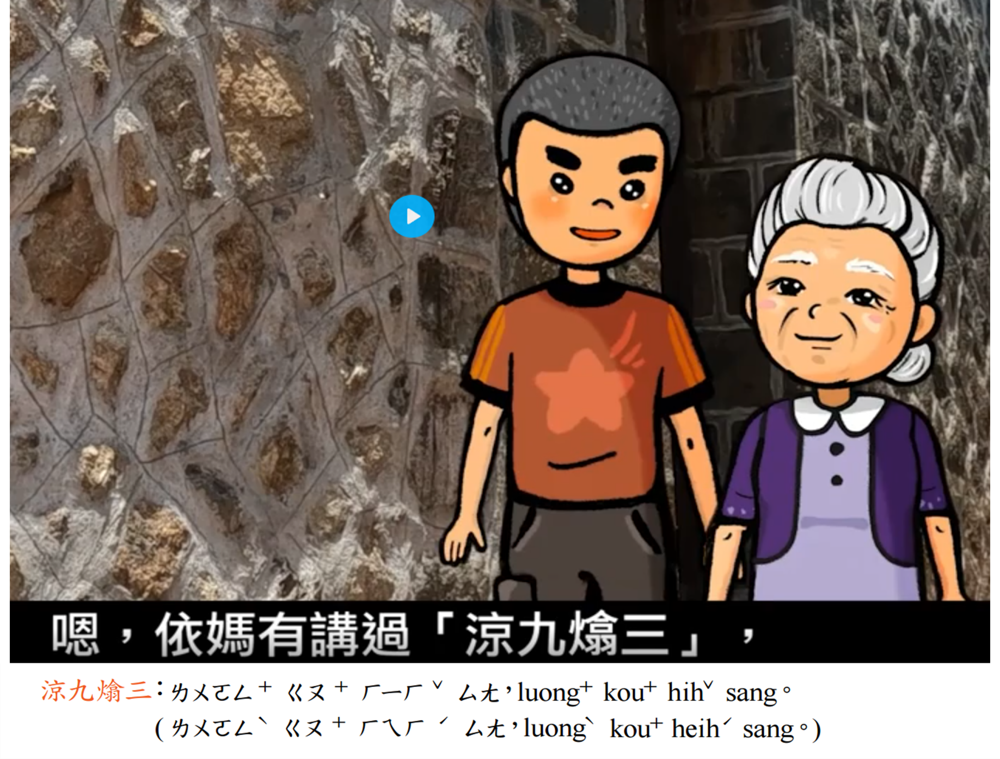
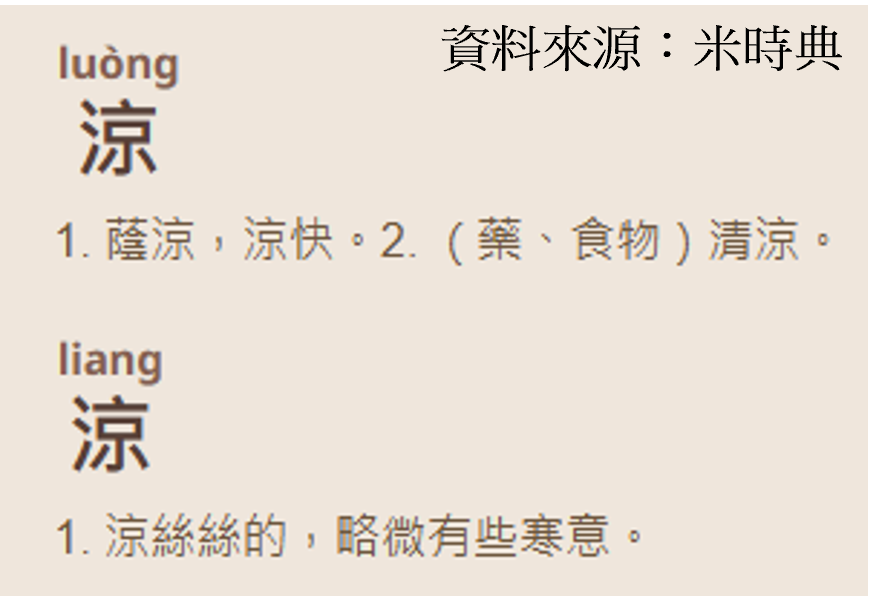

「**涼九熻三**」是一句馬祖話氣候俗諺。意思是：農曆九月，天氣轉涼，衣著無需太多，少穿些無妨；陽春三月，天氣漸暖，卻不能少穿衣，仍需保暖。

教育部發行的《閩東語分級教材 ( 第四級 ) 第 8 冊》的第一課〈九月九〉有講到這個詞，惟其將「涼」字讀作 luong（如圖，影片來源 <https://stv.naer.edu.tw/watch/348803> -2:24），此似有商榷空間。

{.lightbox fig-align="left" width="75%"}

首先，是讀音。  涼字在馬祖話有二種讀音，讀 liang 時（華語讀音 $\approx$ 亮），表示「略有寒意」，特別是秋天或春天時的天氣；讀 luong 時（華語讀音 $\approx$ 羅+嗡），則是指「涼快、清涼、涼爽」的意思。

{.lightbox fig-align="left" width="50%"}

同樣一句話：「今旦野[涼]{.emphasis-circle}」。涼字讀 luong， 表示「今天天氣很涼爽」；若是讀 liang，則表示「今天天氣略有寒意」，其語意完全不同。若以「涼九熻三」的語境（context, 講這話時的情境）來看，「涼」應讀作 liang 才是（此與個人的母語記憶吻合）。中國大陸現行常見的福州方言詞典，也多標音為 liang。[^1] [^2]

[^1]: 陳澤平、林勤《福州方言大詞典》（2021）p.368

[^2]: 李如龍等《福州方言詞典-修訂版》（1996）p.184

其次，是字形。寫作「涼」？還是「晾」？  如果從「動詞對應」和「穿著建議」的角度看，用「晾」字似乎更合理。因為「熻」是動詞，引申作「裹緊、保溫」，「熻三」指三月要多穿點。與之對應的「九」字前，應也用動詞，以形成「動詞+月份」的平行修辭結構。「晾」字作動詞意為「使…通風、使…乾」，例如：「晾凍」、「晾和」。是以「晾九」指九月可以「穿得通風些」，就穿衣的動詞屬性而言，應屬合理。前述的福州方言詞典和福建當地的媒體，也多寫作「晾九熻三」，而非「涼九熻三」。

#### **同場加映**：「凉」是「涼」? 差一點，有差嗎？

1.  有人認為「凉」是「涼」的簡體字，但這似乎有問題（省這一點要幹嘛呢？）[^3]

[^3]: <https://www.mrrm.com.hk/i/?p=2067>

<!-- -->

3.  有人認為「凉」不是「涼」的簡體字。本來就是兩個字。三點水邊的「涼」，本義是寒粥，或者是用水溝酒；「凉」字則是地名，即漢代十三刺史部的凉州，在今日甘肅省及寧夏全境、青海東北部等地一帶……。[^4]

[^4]: <https://pse.is/9qgqkt>

<!-- -->

3.  臺灣教育部的異體字字典則稱：「凉」為「涼」之異體字，而中國大陸則是將「凉」列作規範漢字。於是電視劇《三生三世十里桃花》的片尾曲，在中國大陸寫作〈凉凉〉，在臺灣則寫作〈涼涼〉。[^5]

[^5]: <https://dict.variants.moe.edu.tw/dictView.jsp?ID=23967>

還真有點煩人哪! 就來聽這首「凉凉」或是「涼涼」吧! <https://www.youtube.com/watch?v=jGQ-RdeSndQ&list=RDjGQ-RdeSndQ&start_radio=1>
