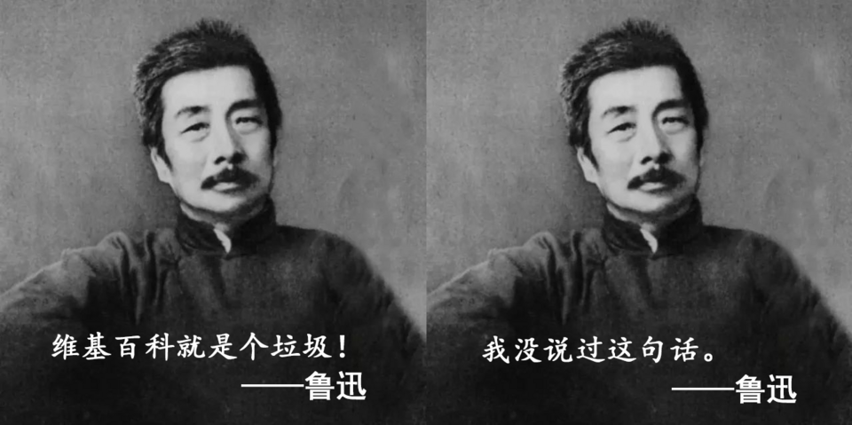

余英時序「…史景遷的著作必須劃入《史記》的類別之內…」。文人相互吹捧，無可厚非，但要說這本書能劃入《史記》類別，司馬遷可能有意見。

作者自序「書中的中國人都是**某種形式**的知識分子…這樣的人物著實也容易較別人早一步捐驅…。」作者沒有具體指出「某種形式」是什麼形式。如果以「捐驅」作指標的話，應該是：譚嗣同、秋瑾、鄒容、瞿秋白、李大釗、宋教仁、聞一多…。而作為本書主線的康有為和魯迅，顯然不是這種形式。

康有為的流亡其實比較像是周遊列國，他還自稱「康聖人」。但是孔子周遊列國時，沒有拿著華僑的捐款去墨西哥抄地皮，沒有去印度大吉嶺住別墅，更沒有在瑞典買小島。本書對康有為夢囈式的《大同書》頗有著墨，甚至引述其中一段寫到女性（女權主義?）的文字，稱其「淋漓盡致」，但康有為一生妻妾成群，六十多歲時娶的六姨太，新娘只有十多歲。這些在本書都沒寫到，或僅輕輕帶過。

至於魯迅，1932年一二八事變，上海軍民奮勇抗日，而他郤在日本人內山完造的庇護下，躲在租界吃大餐，甚至「邀妓」[^1]…。這是那裡的「民族魂」? 至於「硬骨頭」，他似乎只對國民黨硬，對日本人好像硬不起來？魯迅的小說經常揭示人的精神病態，而他這種「躲進小樓成一統」的行徑，何嘗不也是一種病態？ 這些在本書也沒交待。

[^1]: 張東園，看看真實的魯迅：淞滬抗戰狎妓作樂。 <https://hk.aboluowang.com/2021/1118/1673085.html> Accessed: 2026.09.10

書中有部分內容頗有商榷餘地，例如：

1.  「…（在仙台醫專）魯迅雖然每一科都及格（解剖學優，生理學佳，大體解剖及德語稍遜），但還是在學醫的第二年（1905年）決定退學。」（第102頁）  但根據維基百科記載其同班同學小林茂雄保存的資料，魯迅在1905年期末成績如下：解剖學：59.3 分、組織學：72.7 分、生理學：63.3 分、倫理學：83 分、德語：60 分、物理學：60 分、化學：60 分。本書作者沒有查證嗎？

{.lightbox fig-align="left" width="70%"}

2.  「1927年三月底，…康有為將朝服放床上，虔心沐浴，端坐朝服旁，半小時後便腦溢血辭世。」（第300頁）把康有為寫得像是某個悲劇英雄，烈士般的歷史謝幕。  康有為的死，維基百科上有多種說法，包括他女兒說是被人毒死，也有說是被慈禧餘黨暗害，甚至有「割睪易腺」致死說，但就是沒有腦溢血這種說法，實在奇怪。

康有為和魯迅究竟是什麼「形式」的知識分子？是「咒誓予別人死」、「死道友不死貧道」這種形式的嗎？或是如塔雷伯（Nassim Taleb）在 ***Skin in the Game*** 書中所稱：完全不承擔「下行風險（downside risk）」的偽君子? 甚或就是投機分子，言行不一的「人」!？這似乎得有個說法。

**個人意見**：好看的故事。至於「歷史準確度」或是「平衡報導」？不好說。其次，譯筆堪稱流暢，但有些用詞顯得刻意「高大上」，例如：中國「杌**𣕕**不安」[^2]的縮影…（第139頁）、草草「鞫訊」之後…（第311頁），似乎沒必要如此。

[^2]: 「**𣕕**」屬於罕用字（Unicode 表意文字擴展區 B），通常在手機或平板無法正常顯示這個字（出現豆腐塊），需要經過特別處理。「杌**𣕕**不安」其實就是「動盪不安」的意思。
